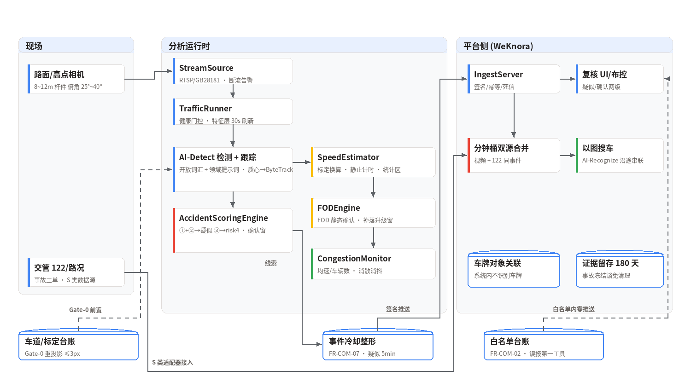

<div align="center">


**交通事件三域视频分析：遗撒散落物 + 事故复合评分分级 + 拥堵监测。疑似/确认两级口径，认定权在交管。**


<!-- 发布时将 OWNER/REPO 替换为实际仓库路径, 并将 ci.yml 复制到 .github/workflows/ci.yml -->


**[English](README_en.md)** | 简体中文


*图：路面点位处理流程（真实管道输出）——事故车损与路面碎屑经开放词汇检出后，复合评分引擎按 FR-AC-02 产出"疑似事故"，倒地人命中即升 risk 4；3 分钟持续确认窗自动升级/关闭，系统始终只输出"疑似/较可能"。*

</div>

---

## 1. 背景与挑战

城市道路/快速路/园区道路的交通异常事件检测，长期存在四项结构性难题：

| 挑战 | 现状描述 |
|------|---------|
| 遗撒是小目标+运动模糊 | 行驶中掉落物常 <32px 且带运动模糊，开放词汇检测图级检出 0%——强行上线就是误报机器（130 图实测印证） |
| 事故不是单一检测目标 | 事故是"异常停车+碎屑+倒地人"的**复合判定**；公交靠站/临停/拥堵缓行都是"停车"，单车临停即报事故的系统（评分 OR/AND 颠倒）误报没有下限 |
| 拥堵与事故互为干扰 | 拥堵被误判为事故、事故淹没在拥堵里——排队中的静止车辆必须被结构性排除 |
| 认定权与合规 | 事故认定权在交管；车牌不在系统内识别；当事人影像按级掩码——任何越权输出都是合规事故 |

## 2. 三类事件，分级承诺（范围先行）

| 事件 | type | 档位 | 承诺口径 |
|------|------|------|---------|
| 路面散落物 (FOD) | `traffic/dropping` | T2 | **承诺达标精度**：车道内新增+静止 ≥10s 双条件，避开运动模糊（R≥85%/P≥80% 设计值） |
| 行驶掉落 | `traffic/dropping` | T2 低限 | **只承诺疑似**：货车尾部运动特征产出"疑似掉落"，120s 观测窗静态确认后升级合并，以图搜车串联取证 |
| 事故 | `traffic/accident` | T2~T3 | **复合评分分级**：疑似级偏召回立即推（≤60s），确认级靠 3min 持续确认窗+交管 122 双源 |
| 拥堵 | `traffic/congestion` | T1 | 成熟能力：均速+车辆数持续判定，消散事件供信号配时联动 |

**范围外声明（第一原则）**：系统输出"疑似/较可能"，**不构成事故形态认定或责任判断**
——认定权在交管；车牌识别不在系统内做（挂载卡口/交管车牌对象，L2 掩码由
平台执行）；高速场景对接甲方既有 AID 系统（S 类），不重复建设。

## 3. 三引擎 + 一个底座

| 模块 | 职责 | 回答的问题 |
| --- | --- | --- |
| 检测底座（AI-Detect 开放词汇） | 车辆/散落物/倒地人/车体异常检出 | "画面里有可判定的对象吗？"（领域提示词产线化：`damaged car / fallen motorcycle / scattered rubble on road…`） |
| AccidentScoringEngine | 事故复合评分 | "①异常停车 **且** ②碎屑 → 疑似；+③倒地人/④车体异常 → 较可能；③命中 risk 即升 4。3 分钟后特征还在吗？" |
| FODEngine | 遗撒双路线 | "车道内新增的静止小目标确认了吗？掉落 120s 内路面静态确认了吗？"（升级合并串联两段证据） |
| CongestionMonitor | 拥堵+消歧上下文 | "统计区均速持续低于阈值吗？恢复满 120s 了吗？"——排队态实时供事故通道消歧 |

四个模块是流水线，不是孤岛：检测底座管召回（领域提示词把事故特征图级检出
从 0% 拉到 50%、散落物从 0% 到 79%——提示词工程是决定性的），速度标定层
管"该不该判"（无标定不开启速度类判定），拥堵通道给事故通道提供排队消歧，
持续确认窗用时间换精度——疑似级 60s 内抢响应，误报由复检自动关闭消化。

## 4. 技术亮点

- **持续确认窗状态机（FR-AC-04 的可运行实现）**——特征持续 ≥3min →
  confirmed（与 suspected 同稳定事件键，平台幂等合并即"事件内升级"）；
  特征消失 ≥30s → 自动关闭（confirmed=false 复核建议）；关闭后 5min 冷却内
  复现不重推疑似，但持续到窗仍会 confirmed（安全网不丢事件）。
- **涉人零漏的一票否决路径**——③倒地人命中即 risk 升 4、不等确认窗；
  ③单独出现也产出事件（升级捕获率一票否决项）；冷却永不抑制涉人升级。
- **提示词工程决定成败的量化证据**——同一批 130 图：通用提示词 + tiny@0.30
  散落物/事故特征全为 0%；领域提示词 + base@0.15 后散落物 79%、事故特征
  50%。领域提示词已产线化进 `runner.DETECTOR_PROMPTS`，随代码交付。
- **白名单/车道/标定三层消歧全部生效**——车道多边形过滤（车道外目标不报）、
  白名单台账（公交站/施工区/锥桶，两轮静默测试）、拥堵排队消歧（排队中的
  静止不计①）、施工区时段消歧。
- **诚实的第一误报治理工具**——白名单台账是试运行期主战场：勘察同步登记、
  周台账治理、台账稳定后转全量（治理流程写进实施流程）。
- **fail-loud 与降敏**——断流 ≤30s 运维告警；夜间 FOD 降敏（面积阈值加倍）
  并标注 degraded、行驶掉落停判；恶劣天气 MTTD 口径放宽一档并按天气分桶
  签认（§8.6 降级声明机制）。
- **契约合规内建**——每条 Clue 经 `clue_to_event_input` + `validate_event_input`
  双校验（130 图 E2E 113/113 通过）；措辞纪律：一律"疑似"，定性词不出现。

## 5. 效果图

以下标注均为真实管道输出（检测框与置信度取自 130 图回归
`detections_v3.json`，未经手工修改）。

正面场景（每张含真实检出框、置信度与 FR 追溯）：

| 疑似事故 (车损+碎屑) | 路面散落物 | 倒地摩托车 |
|:---:|:---:|:---:|
|  |  |  |
| **路面石块 (小目标)** | **拥堵监测 (航拍)** | **夜间降敏** |
|  |  |  |

消歧负样本（正确不报 = 系统的另一半能力）：

| 正常通行 (航拍) |
|:---:|
|  |

总览：


## 6. 端到端流程示例

以一次事故疑似事件为例（时间为示意，判定与路由为真实逻辑）：

| 时刻 | 环节 | 说明 |
|------|------|------|
| 09:02:10 | 特征层刷新 | 30s 粒度：行车道内静止 ≥30s 的车辆 + 路面碎屑检出 |
| 09:02:10.1 | 消歧 | 排队态查询（无）/ 白名单核对（无）/ 车道归属（行车道内 ✓） |
| 09:02:10.2 | 复合评分 | ①+② 同时成立 → **suspected** risk3，60s 内推送抢响应 |
| 09:02:41 | 涉人升级 | ③倒地人命中 → risk **即升 4**，不等确认窗 |
| 09:05:10 | 持续确认 | 特征持续 ≥3min → **confirmed**（同事件键，平台合并证据） |
| 09:08:00 | 车辆驶离 | 特征消失 ≥30s → 自动关闭（confirmed=false 复核建议） |
| 案后 | 以图搜车 | 嫌疑车 crop 入 AI-Recognize 索引 → 沿途点位-时间线（遗撒串联/逃逸辅助） |

## 7. 关键指标

基准口径：**130 张百度图片（散落物 34 / 事故 34 / 拥堵 26 / 负样本 24 /
夜间 12，内容哈希去重），AI-Detect（base 权重） + 领域提示词 @0.15，图像级检出 +
TrafficRunner 全链路（特征层→引擎→Clue→契约校验）**，详见
[实测报告](../../demo_outputs/traffic_image_test/REPORT.md)。

| 指标 | 数值 | 口径 |
|------|------|------|
| **vehicle 图级 R/P/F1** | **0.932 / 0.940 / 0.936** | 130 图人工真值（GT 开发集），切片推理 + 逐提示词阈值 |
| **debris 图级 R/P/F1** | 全域 0.897/0.591/**0.712**；**FOD 部署域 0.889/0.696/0.780** | 同上；全域 FP 集中在事故场景杂物，由 FOD 静态确认窗+白名单兜底 |
| **accident 图级 R/P/F1** | 全域 0.750/0.808/**0.778**；事故域内 0.75/0.95/**0.84** | 倒地人阈值受涉人零漏约束（≤0.30） |
| E2E 契约校验 | **131/131 通过** | TrafficRunner 全链路；负样本/夜间线索级误报 **0** |
| 感知层配置 | 15 提示词逐类阈值 + 5 负提示 + 切片推理 + 夜间门控 | 全部写回 `runner.py` 生产配置 |
| 单元测试 | **49 项全绿**（含离线指标门禁） | F1 跌穿地板 CI 即失败；全仓回归零新增失败 |
| 修复叙事 | 8 项缺陷（4 P0）→ 0 + 感知层 6 项根因修复 | 每项有复现脚本与回归测试（见实测报告 v3） |

> **诚实口径**：指标为 **130 图人工真值集（图级"存在性"检测，单人标注
> +争议全分辨率复核）**，非逐框 AP；无时序（MTTD/确认窗为模拟口径）、
> 无地面标定。R≥85%/P≥80% 等为**设计目标值**（§5.1），正式验收必须按
> §8.2 封闭场摆拍 + 回放注入执行。全域 debris P 0.59 的残余 FP 集中在
> 事故场景杂物（部署语义下由 FOD 静态确认窗 + 白名单兜底）；切片推理
> 已把航拍小目标从"单图数百辆检出个位数"拉回图级 R 0.93。

## 8. 快速开始

```python
from traffic_guard.registry import LaneSpec, RoadSegment, SpeedCalibration
from traffic_guard.runner import (TrafficRunner, TrafficRunnerConfig,
                                  WeDetectBackend)

seg = RoadSegment(
    "ROAD-1",
    lanes=[LaneSpec("L1", ((0, 0), (960, 0), (960, 540), (0, 540)))],
    calibration=SpeedCalibration((100, 500), (500, 500), distance_m=24.0))
seg.add_whitelist("bus_stop", ((100, 100), (200, 100), (200, 200),
                               (100, 200)), 0, 1e12)

backend = WeDetectBackend(            # 检测后端可注入替换
    "wedetect_hf_models/wedetect-base", device="cuda")
runner = TrafficRunner(seg, config=TrafficRunnerConfig(point_id="ROAD-1"))

for frame in frames:                  # 720P@10fps 抽帧
    dets = backend.detect(frame)      # → [{bbox, label, score}]
    clues = runner.process(dets, ts=now)
    # → traffic/accident·suspected(3) / probable(4) / confirmed
    # → traffic/dropping·fod / suspected_drop
    # → traffic/congestion·congestion / resolved
```

```bash
# 单元测试 (无 GPU 环境, 检测后端注入式)
pytest traffic_guard/tests -q

# 130 图端到端复现 (需模型权重; 见 demo_outputs/traffic_image_test/)
python demo_outputs/traffic_image_test/fetch_images_v2.py     # 抓取测试图
python demo_outputs/traffic_image_test/run_traffic_e2e_v2.py  # 检测+引擎
python demo_outputs/traffic_image_test/run_e2e_after_fix.py   # 全链路复测
```

## 9. 系统架构



## 10. 范围与限制

- **运行面组件未接线**：RTSP/GB28181 帧源、AI-Reference 二段确认、证据
  落盘、相机健康校验、AI-Recognize 以图搜车、交管 122 双源适配器——
  设计文档 FR-COM-01~11 的平台侧组件依赖 WeKnora 平台与 perimeter_guard
  同构骨架，当前交付为决策层 + 单通道编排（`runner.py`）。
- **跟踪为质心法**：`runner.CentroidTracker` 为注入式占位，生产环境替换
  ByteTrack（§4.1，IDF1 ≥78% 进验收）——密集车流场景质心法不够。
- **130 图为网络图片冒烟口径**：§8.2 验收数据集（封闭场摆拍 ≥100 组 +
  回放注入 ≥100 段 + 负样本每类 ≥50 段）未建设；SLO 数值未经实测。
- **涉人升级依赖倒地人检出**：人形躺卧姿态的检出能力即系统能力边界；
  无姿态服务点位用"人形纵宽比"近似（精度降档声明）。
- **小目标是硬边界**：行驶掉落只承诺疑似口径；夜间停判；航拍高点需
  专用小目标模型或更高分析分辨率。

## 11. License 与数据声明

代码为商业软件（Commercial Software），未经授权不得复制、修改、分发或
商用。测试图片来自百度图片搜索（`fetch_images_v2.py` 可复现抓取，标注
仅供研究），**不随仓库分发**；`detections_v3.json` / `e2e_after_fix.json`
与评估报告随仓库提供。系统输出"疑似/较可能"，不构成事故认定或执法证据；
事故当事人影像仅向交管/应急授权角色开放，导出审批留痕。
