<div align="center">

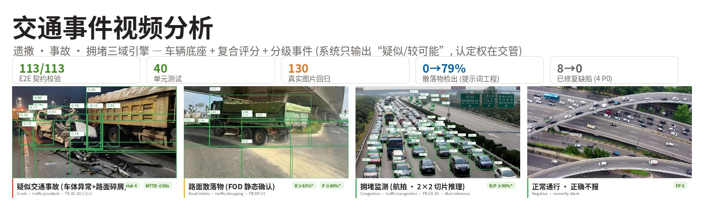

**Three-domain traffic incident video analytics: road debris (FOD) + composite accident scoring with graded events + congestion monitoring. Suspected/confirmed two-tier claims — determination authority stays with traffic police.**


[](https://github.com/hi-agi-lab/AutoVision)
[](https://pypi.org/project/autovision-framework/)

English | **[简体中文](README.md)**

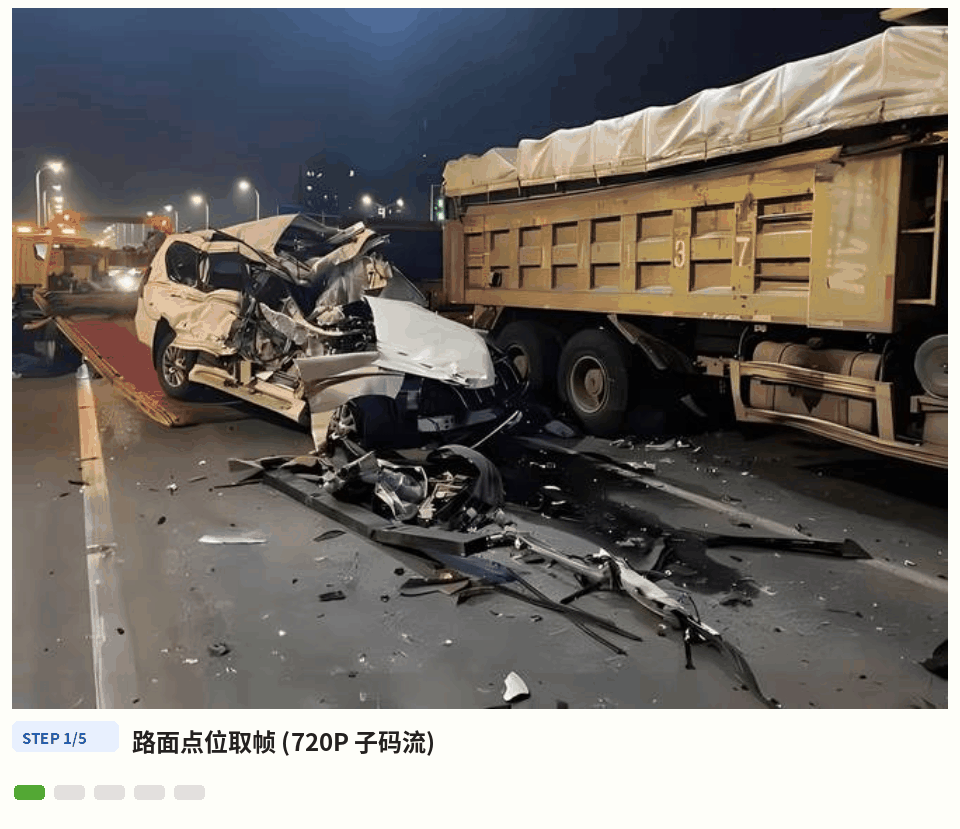

*Fig: Road-side processing pipeline (real pipeline output) — crash damage and road debris detected by open-vocabulary prompts, composite scoring emits a "suspected accident" per FR-AC-02, a lying person escalates risk to 4 immediately, and the 3-minute confirmation window auto-upgrades or auto-closes. The system only ever outputs "suspected / probable".*

</div>

---

## 1. Background & Challenges

Detecting abnormal traffic incidents on urban roads faces four structural gaps:

| Challenge | Description |
|------|---------|
| Debris = tiny objects + motion blur | Objects dropped while driving are often <32px with motion blur; open-vocabulary image-level detection was **0%** in our regression — shipping that as-is is a false-alarm machine |
| Accidents are not a single detection target | An accident is a **composite** of abnormal stop + debris + person-down; bus stops, drop-offs and congested queues are all "stopped vehicles". A scorer that ORs the features (a real bug we found and fixed) has no false-alarm floor |
| Congestion vs. accident interference | Congestion gets misread as accidents; accidents drown in congestion — stationary vehicles inside a queue must be structurally excluded |
| Determination authority & compliance | Accident determination belongs to the traffic authority; no license-plate OCR inside the system; victim imagery tiered and masked |

## 2. Three Event Classes, Graded Claims (scope first)

| Event | type | Tier | Claim |
|------|------|------|---------|
| Road debris (FOD) | `traffic/dropping` | T2 | **Accuracy committed**: new + stationary ≥10s inside lane ROI (design R≥85%/P≥80%) |
| Moving-vehicle drop | `traffic/dropping` | T2 low | **Suspected only**: truck-tail motion produces a "suspected drop"; 120s observation window upgrades on static confirmation; vehicle image-search chains the trail |
| Accident | `traffic/accident` | T2~T3 | **Composite graded scoring**: suspected fires fast for response (≤60s), confirmed relies on a 3-min window + traffic-authority dual sources |
| Congestion | `traffic/congestion` | T1 | Mature: sustained mean-speed + vehicle-count, resolve events feed signal control |

**Out-of-scope declaration (first principle)**: the system outputs "suspected /
probable" only and **never constitutes accident determination or liability
assessment** — that authority belongs to the traffic police. No license-plate
recognition inside the system (plate objects linked from checkpoint/authority
feeds, masked by the platform). For highways we integrate the customer's
existing AID system (S-adapter) instead of rebuilding one.

## 3. Three Engines + One Base

| Module | Role | Question it answers |
| --- | --- | --- |
| Detection base (AI-Detect open-vocabulary) | vehicles / debris / person-down / vehicle damage | "Is there anything decidable in the frame?" (productionized domain prompts: `damaged car / fallen motorcycle / scattered rubble on road…`) |
| AccidentScoringEngine | composite accident scoring | "① abnormal stop **and** ② debris → suspected; +③ person-down / ④ damage → probable; ③ escalates risk to 4 immediately. Are the features still there after 3 minutes?" |
| FODEngine | dual-route debris | "Is the new stationary small object inside the lane ROI confirmed yet? Did the drop statically confirm within 120s?" (upgrade merges two evidence segments) |
| CongestionMonitor | congestion + disambiguation context | "Is the zone mean-speed below threshold sustainably? Has recovery lasted 120s?" — queue state feeds the accident channel in real time |

The four modules form a pipeline, not silos: the detection base owns recall
(domain prompts lifted accident features 0%→50% and debris 0%→79% image-level
— prompt engineering is decisive), the calibrated speed layer owns "should
this be judged at all", the congestion channel feeds queue disambiguation to
the accident channel, and the confirmation window trades time for precision —
suspected fires within 60s to buy response time while false alarms are
absorbed by auto-close on recheck.

## 4. Highlights

- **Confirmation-window state machine (runnable FR-AC-04)** — features
  sustained ≥3min → confirmed (same stable event key as suspected, so the
  platform idempotently merges the upgrade); features gone ≥30s → auto-closed
  (confirmed=false review suggestion); within a 5-min cooldown after closing,
  re-onset does not re-push suspected, but sustained features still confirm
  (a safety net that never drops events).
- **Person-down zero-miss path (veto item)** — ③ escalates risk to 4
  immediately, never waiting for the window; ③ alone produces an event;
  cooldown never suppresses person-down escalation.
- **Quantified evidence that prompt engineering is decisive** — same 130
  images: generic prompts + tiny@0.30 scored 0% on both debris and accident
  features; domain prompts + base@0.15 lifted debris to 79% and accident
  features to 50%. The prompt set ships in `runner.DETECTOR_PROMPTS`.
- **Three disambiguation layers, all live** — lane-polygon filtering (nothing
  outside lanes reports), whitelist ledger (bus stops / work zones / cones,
  two-round silent test), queue disambiguation (stationary-in-queue doesn't
  count as ①), plus time-boxed work-zone suppression.
- **Honest FP-governance tooling** — the whitelist ledger is the #1 FP tool
  during trial runs: registered at survey time, governed weekly, and gated
  before full rollout.
- **Fail-loud & degradation** — stream loss alerts ops within 30s; night mode
  doubles the FOD area threshold and marks clues `degraded`, moving-drop
  judgement stops at night; weather-bucketed MTTD relaxation is contractually
  signable (§8.6).
- **Contract compliance built-in** — every Clue passes
  `clue_to_event_input` + `validate_event_input` (113/113 in the 130-image
  E2E); wording discipline: always "suspected", never a determination term.

## 5. Gallery

All annotations are real pipeline outputs (boxes and scores from the
130-image regression `detections_v3.json`, unmodified).

| Suspected accident (damage + debris) | Road debris (FOD) | Fallen motorcycle |
|:---:|:---:|:---:|
| 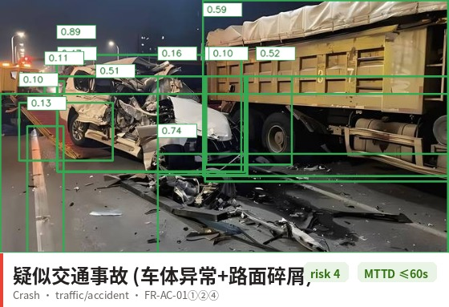 | 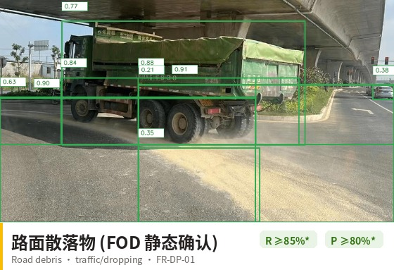 | 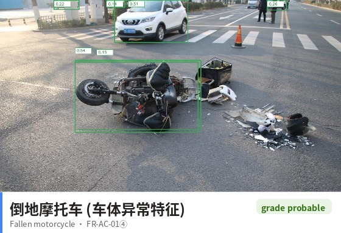 |
| **Stones (small object)** | **Congestion (aerial)** | **Night degradation** |
| 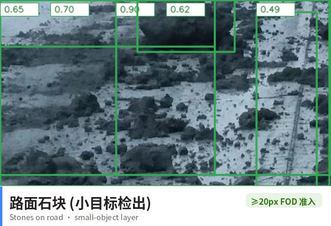 | 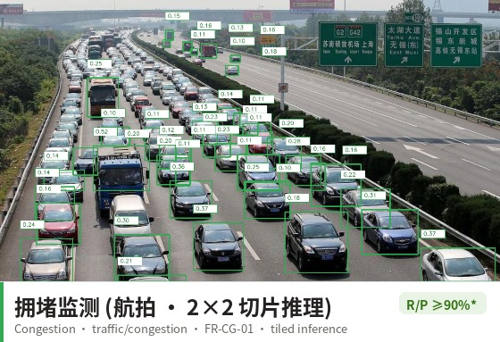 | 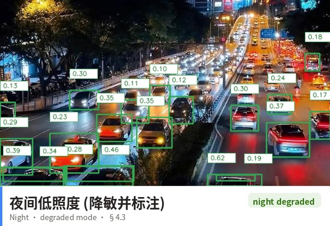 |

Negative (correctly silent — the other half of the capability):

| Free-flowing traffic (aerial) |
|:---:|
| 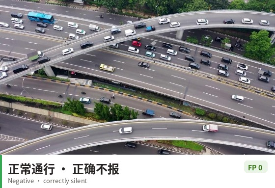 |

Overview:

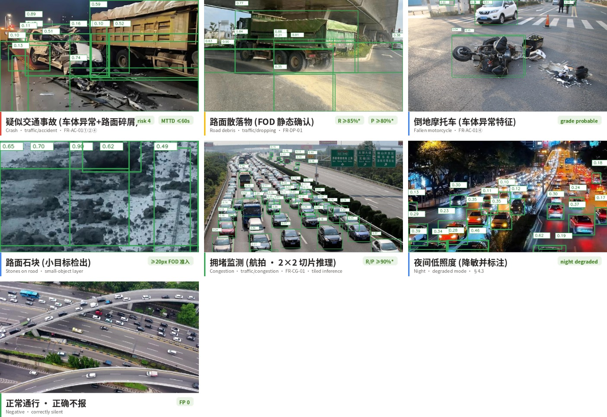

## 6. End-to-End Walkthrough

A suspected-accident timeline (times illustrative, logic real):

| Time | Stage | Description |
|------|------|------|
| 09:02:10 | Feature refresh | 30s cadence: vehicle stationary ≥30s inside a driving lane + road debris detected |
| 09:02:10.1 | Disambiguation | queue-state query (no) / whitelist check (no) / lane membership (driving lane ✓) |
| 09:02:10.2 | Composite scoring | ①+② both hold → **suspected** risk3, pushed within 60s |
| 09:02:41 | Person-down escalation | ③ hit → risk **escalates to 4 immediately** |
| 09:05:10 | Confirmation window | features sustained ≥3min → **confirmed** (same event key, platform merges evidence) |
| 09:08:00 | Vehicle departs | features gone ≥30s → auto-closed (confirmed=false review suggestion) |
| Post-incident | Vehicle image-search | suspect-vehicle crop indexed into AI-Recognize → cross-camera point-timeline |

## 7. Key Metrics

Benchmark: **130 Baidu-searched images (debris 34 / accident 34 / congestion
26 / negative 24 / night 12, content-hash deduplicated), AI-Detect (base weights) +
domain prompts @0.15, image-level detection + full TrafficRunner chain
(features → engines → Clue → contract validation)**, see the
[measurement report](../../demo_outputs/traffic_image_test/REPORT.md).

| Metric | Value | Scope |
|------|------|------|
| **Vehicle image-level R/P/F1** | **0.932 / 0.940 / 0.936** | 130-image hand-labeled GT dev set, tiled inference + per-prompt thresholds |
| **Debris image-level R/P/F1** | all-domain 0.897/0.591/**0.712**; **FOD deployment domain 0.889/0.696/0.780** | all-domain FPs concentrate in crash-scene clutter, backstopped by the FOD static-confirmation window + whitelist |
| **Accident image-level R/P/F1** | all-domain 0.750/0.808/**0.778**; in-domain 0.75/0.95/**0.84** | person-down threshold capped ≤0.30 (zero-miss veto constraint) |
| E2E contract validation | **131/131 passed** | full TrafficRunner chain; negative/night clue-level FPs **0** |
| Perception config | 15 prompts, per-prompt thresholds, 5 negative prompts, tiled inference, night gate | all committed to `runner.py` production config |
| Unit tests | **49 passing** (incl. offline metric gate) | CI fails if F1 drops below floors; repo regression unbroken |
| Defect narrative | 8 defects (4 P0) → 0 + 6 perception root-cause fixes | each with repro script and regression test |

> **Honest scope**: metrics are on a **130-image hand-labeled GT dev set
> (image-level presence detection, single annotator with full-resolution
> adjudication of disputed cases)**, not per-box AP; no temporal streams
> (MTTD / confirmation window simulated), no ground calibration. R≥85%/P≥80%
> etc. are **design targets** (§5.1); formal acceptance requires the §8.2
> closed-course staged dataset. The all-domain debris P of 0.59 is dominated
> by crash-scene clutter (backstopped in deployment by the FOD confirmation
> window + whitelist); tiled inference lifted aerial small objects from
> "single digits out of hundreds per frame" to image-level R 0.93.

## 8. Quick Start

```python
from traffic_guard.registry import LaneSpec, RoadSegment, SpeedCalibration
from traffic_guard.runner import (TrafficRunner, TrafficRunnerConfig,
                                  WeDetectBackend)

seg = RoadSegment(
    "ROAD-1",
    lanes=[LaneSpec("L1", ((0, 0), (960, 0), (960, 540), (0, 540)))],
    calibration=SpeedCalibration((100, 500), (500, 500), distance_m=24.0))
seg.add_whitelist("bus_stop", ((100, 100), (200, 100), (200, 200),
                               (100, 200)), 0, 1e12)

backend = WeDetectBackend(            # detector backend is injectable
    "wedetect_hf_models/wedetect-base", device="cuda")
runner = TrafficRunner(seg, config=TrafficRunnerConfig(point_id="ROAD-1"))

for frame in frames:                  # 720P@10fps sampling
    dets = backend.detect(frame)      # → [{bbox, label, score}]
    clues = runner.process(dets, ts=now)
    # → traffic/accident·suspected(3) / probable(4) / confirmed
    # → traffic/dropping·fod / suspected_drop
    # → traffic/congestion·congestion / resolved
```

```bash
# Unit tests (no GPU; detection backend injectable)
pytest traffic_guard/tests -q

# 130-image E2E reproduction (needs model weights)
python demo_outputs/traffic_image_test/fetch_images_v2.py
python demo_outputs/traffic_image_test/run_traffic_e2e_v2.py
python demo_outputs/traffic_image_test/run_e2e_after_fix.py
```

## 9. Architecture

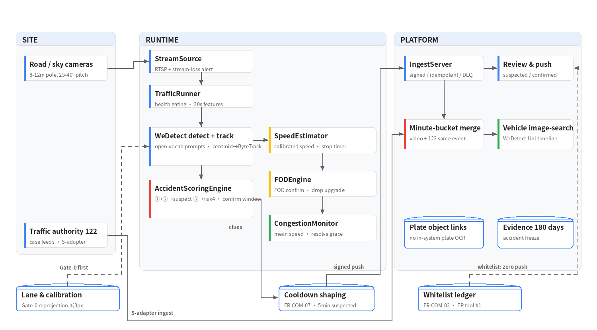

## 10. Scope & Limitations

- **Runtime-plane components not wired yet**: RTSP/GB28181 frame sources,
  AI-Reference two-stage confirmation, evidence store, camera health checks,
  AI-Recognize vehicle image-search, and the 122 dual-source adapter — the
  platform-side FR-COM-01~11 components depend on the WeKnora platform and
  perimeter_guard-style skeletons; this delivery is the decision layer plus
  a single-channel orchestrator (`runner.py`).
- **Tracking is centroid-based**: `runner.CentroidTracker` is an injectable
  placeholder; production replaces it with ByteTrack (§4.1, IDF1 ≥78% into
  acceptance) — dense traffic needs more than centroid matching.
- **130 web images are a smoke scope**: the §8.2 acceptance dataset
  (≥100 staged crash setups + ≥100 replay clips + ≥50 negatives per class)
  is not built; SLO numbers are unmeasured.
- **Person-down escalation is bounded by detection**: lying-pose detection
  capability is the system's boundary; sites without pose services fall back
  to aspect-ratio approximation (declared downgrade).
- **Small objects are a hard boundary**: moving drops are suspected-only;
  night judgement stops; aerial points need a dedicated small-object model
  or higher analysis resolution.

## 11. License & Data Statement

Commercial software; no copying, modification, distribution or commercial
use without authorization. Test images come from Baidu image search
(`fetch_images_v2.py` reproduces the crawl; annotations for research only)
and are **not distributed with the repository**; `detections_v3.json` /
`e2e_after_fix.json` and the report ship with the repo. The system outputs
"suspected/probable" and never constitutes accident determination or law-
enforcement evidence; accident imagery is restricted to authorized
traffic-authority/emergency roles with audited export.

---

The detection backbone, streaming inference runtime, and export chain of this solution are provided by the open-source framework [AutoVision](https://github.com/hi-agi-lab/AutoVision) (`pip install autovision-framework`); see the [integration design](https://hi-agi-lab.github.io/AutoVision/ecosystem/) for details.
